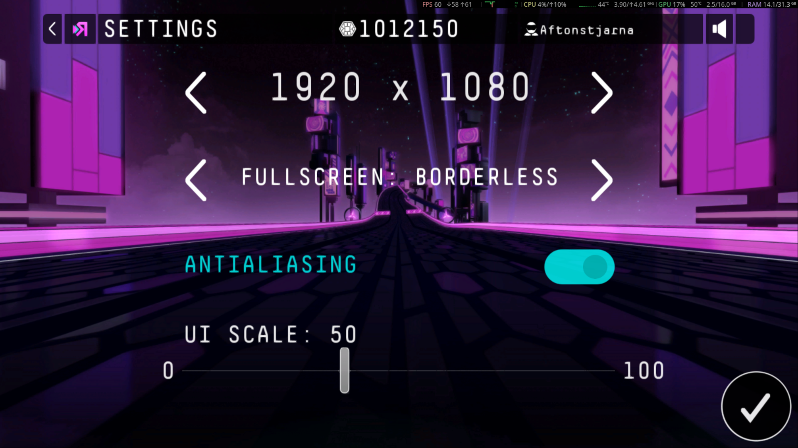

# ReRiff

Play Riff Racer on Windows or Linux/Proton with restored offline and shared-server
features.

[Download stable 1.2.3](https://github.com/Aftonstjarna/ReRiff/releases/latest)
· [Install and update](#install-or-update)
· [Steam launch options](#launch-through-steam)
· [Server settings](#server-settings)
· [Graphics settings](#graphics-settings)
· [Troubleshooting](#troubleshooting)
· [Server administration](#server-administration-and-technical-details)

- **Singleplayer:** generate tracks and keep scores and ghosts without a server.
- **Shared servers:** use Primary and Secondary addresses for leaderboards and ghosts.
- **In-game settings:** manage server preferences and save, restart or exit.
- **Graphics:** borderless/exclusive fullscreen, higher render resolutions,
  antialiasing and adjustable UI scale.
- **Launcher and updates:** edit settings, opt into betas, or update automatically
  when skipping the launcher.
- **Optional local server:** install and manage a Podman server from the launcher.

**Launcher — ReRiff 1.2.3**


**Settings → Servers**


**Settings → Graphics**



Linux uses Proton; the game still requires its Windows .NET Framework setup.

## Install or update

**Installers support vanilla and existing ReRiff installations.** Setup verifies
the supported DLL hashes and patches the user's local copies when required.
Original game executables, assets, and game-derived binary patches are not included.

Close the game and launcher before a manual installation. Existing settings,
scores, ghosts, and server data are preserved. Client backups are
kept in the game's `bak` folder. Keep this folder when updating. Unknown game DLL
modifications are rejected rather than overwritten.
Matching vanilla backups are checked by SHA256 and kept unchanged. Verified
originals from an older recorded backup folder are copied into `bak` without
changing that older folder. A conflicting backup hash stops installation
without overwriting the backup.

**Windows:** download and extract `ReRiff-<version>-windows.zip`, run
`ReRiff-Setup.exe`, and select the game's `Game.exe`. Keep the ZIP contents
together until setup finishes. Portable Python is included for setup and updates; singleplayer runs inside
the game without a Python server. Local DLL patching uses the game's .NET Framework runtime.
The package targets x64 Windows; the launcher is native x86 Win32.

**Linux/Proton (x86_64):** install Python 3.10 or newer. The Linux
installer opens a native folder picker and setup window when run without
arguments in a desktop session:

```sh
sh ReRiff-<version>-linux.run
```

Choose the folder containing `Game.exe`, click **Install**, and wait for the
result. **Link Linux music folder** is checked by default. Its editable field
uses your XDG Music location (usually `~/Music`). Setup links that folder into
this game's Proton prefix at `drive_c/users/steamuser/Music`, so the game can
browse your music. Uncheck it to skip linking; this preference is retained for
automatic updates. Existing non-empty Music folders inside the prefix are
preserved. If Steam has not created the prefix yet, launch the game once and
rerun setup to apply the link. Terminal installs accept `--music-dir '/your/music'`
or `--no-music-link`. GTK 3 is required for the window and is available on many Steam desktops.
The installer shows progress and details, keeps a log under
`~/.local/state/reriff/` (or `$XDG_STATE_HOME/reriff/`), and reuses the same backup,
verification, and rollback checks as Windows. Choosing a folder alone changes
nothing. A failed installation can be retried from the window.

For a terminal install or a machine without GTK:


```sh
sh ReRiff-<version>-linux.run --game-dir '/path/to/steamapps/common/Riff Racer'
```

Replace `<version>` with the downloaded release number. Omit `--game-dir` to
search common Steam libraries (including Flatpak Steam). Use `--cli` to force
terminal mode, or `--gui` to request the window.
Explicit options such as `--game-dir`, `--dry-run`, `--restore`, and `--help`
keep their terminal behavior for scripts and automatic updates. Do not use `sudo`.
Update and optional-server control helpers live in `localserver/` beside `Game.exe`;
the server image is downloaded separately when requested from the launcher.
It does not change Steam's selected Proton version or launch options.
The Linux installer includes the DLL patcher's runtime; a separate Mono or .NET
installation is not required. If an older package reports that Mono is required,
download the current complete Linux installer or retry the update.

If Windows selects an external server but game features stay offline, include
`logs/ReRiff-network.log` from the game folder when reporting the failure. It records
bounded network and assembly-loading exception details. The startup report
collector includes it automatically.

### Automatic client updates

Upcoming installers add a ReRiff GitHub web shortcut beside the game and a
repository link in setup. These additions are not included in stable 1.2.3.


Click **Update from GitHub** while the game is closed. The launcher downloads
the latest stable release for your platform, verifies its SHA256 and package
contents, applies the update with backups and rollback, then reopens itself.
The title bar shows the running version. Settings and saved data are retained.

If you are using a prerelease, **uncheck Use experimental releases (prereleases)** while the
game is closed to install stable 1.2.3. This works even when your installed
version has a revision suffix such as `1.2.3-8`. New test releases use `X.X.X-beta.N` (for example, `1.2.4-beta.1`); older
`X.X.X-N` releases remain recognized. Stable stays the default update channel.
Launchers from stable 1.2.3 do not recognize the new beta names; install the first
beta manually, or update to a stable launcher with beta-name support first.
Superseded prereleases may be drafted or deleted after stable is verified; they are not offered as current updates.

If your launcher cannot apply an update, install the current release manually.
Client updates do not update the Docker server.

### In-game Servers menu and launcher skipping

Open **Settings → Servers** and use the original
fullscreen-style on/off switches for **Skip launcher**, **Primary server only**,
and **Singleplayer** (Off uses configured servers; On selects local play without
clearing saved addresses). After changing Skip launcher, choose
**Save settings** or **Save and return**. The next start uses this preference;
Back without saving discards the change. The preference is stored in
`server.ini` as `[launcher] skip_launcher=true` or `false`. The launcher's
**Skip launcher** checkbox edits this same preference and refreshes when you
save it in-game. Choose **Save settings** in the launcher to save checkbox edits.

Beside it, **Auto-update when skipping launcher** enables an update check before
starting the game without the launcher window. A small progress window shows
checking, downloading, verification and installation. **Cancel** starts the
installed game; it is disabled once installation is committed, so replacement
or rollback can finish safely. It is Off by default, follows
the installed stable/experimental channel, and resumes the game after an update
with the original arguments. A failed check starts the installed version and
records details in `logs/ReRiff-launcher.log`. Existing settings and saved data are
preserved. To test this path without a duplicate GitHub release, close the game
and run `ReRiff-Launcher.exe --skip-launcher --test-auto-update`. This one launch
can reinstall the same published version using the normal verified updater,
then resume the game without checking again. It will not downgrade to an older
published version; the installed release must include this flag.

This option is configured in the launcher, with
`[launcher] auto_update_on_skip=true` in `server.ini`.

New INI files include `https://riffapi.hobune.stream/` as a commented external
server example. Updates also install `server.ini.example` alongside the game.
Copy the address into `external_url` to select it; the example does not change
your active server.

**Save and restart** saves your changes and
restarts the game immediately so the new server settings take effect. It waits
for the current game to exit before starting a replacement and skips the
launcher window during that restart. A save or restart-handoff failure leaves
the current game running.

Use `--show-launcher` to open the launcher even when this preference is on.
`--skip-launcher`, `--launcher-skip`, and `--skip` explicitly skip it. Launcher
flags override the saved preference, so remove a forced skip flag from Steam's
launch options if you want the in-game toggle to control the next start.

## Launch through Steam

On Windows, run `ReRiff-Launcher.exe` beside `Game.exe`. Add `--skip-launcher`
to start the game without the settings window.

On native Windows, Steam launch options can use:

```text
"C:\Steam\steamapps\common\Riff Racer\ReRiff-Launcher.exe" %command%
```

Use your actual game folder and do not surround the whole line with single
quotes. Steam's forwarded command must point to `Game.exe` beside the launcher.
Put launcher flags such as `--skip-launcher` before `%command%`; game arguments
forwarded after `Game.exe` are retained. Use the current launcher for Steam command forwarding.

On Linux, use the shell bridge to launch the Windows EXE through Steam's Proton.
**Stable 1.2.3** installs it at `localserver/steam-launcher.sh`:

```text
"/path/to/Riff Racer/localserver/steam-launcher.sh" -- %command%
```

**Upcoming installers** also place the bridge beside `ReRiff-Launcher.exe` as
**ReRiff-Launcher.sh**. If that file is present, use:

```text
"/path/to/Riff Racer/ReRiff-Launcher.sh" -- %command%
```

To skip the launcher window:

```text
"/path/to/Riff Racer/ReRiff-Launcher.sh" --skip-launcher -- %command%
```

To test an unattended update on Linux, use:

```text
"/path/to/Riff Racer/ReRiff-Launcher.sh" --test-auto-update -- %command%
```

For stable 1.2.3, substitute `localserver/steam-launcher.sh` in these examples.

Remove `--test-auto-update` after testing. It implies skipping the launcher for
that invocation. Current bridges also recognize this flag after `%command%`.

Both bridge locations retain the same argument forwarding; the old path remains
supported for existing Steam launch options. Do not use the Windows `.exe`
directly before `%command%` on Linux.

The Windows launcher runs in Steam's Proton prefix. Singleplayer storage runs
inside the game; the launcher does not start a local Python server. Keep your existing
working Proton and .NET setup. In Steam, find the game path with **Properties →
Installed Files → Browse**, then edit **Properties → General → Launch Options**.
The launcher waits for the game to exit so Steam keeps the session active.

The News screen shows a short preview of the installed client version's patch
notes while preserving custom server announcements. Choose the original **Visit
URL** action to open that version's complete GitHub release notes. Upcoming builds
use authored summaries of up to three complete points, with more room for detail. Client notes ship with the
installer and do not depend on updating the shared server. Delivery diagnostics
are recorded in `logs/ReRiff-news.log`.

## Server settings

The launcher edits `server.ini` beside `Game.exe`:

- **Primary server:** preferred shared Docker/Podman server address, including its port.
- **Secondary server:** optional fallback address, including the launcher-managed
  local Podman server at `http://127.0.0.1:5144`.
- **Primary server only:** skips the secondary server; singleplayer remains available.
- **Singleplayer:** selects local play while retaining both saved server addresses.
- **Use servers:** enables primary → secondary → singleplayer selection.
- **Install / Start / Stop local server:** optionally downloads and manages the
  official server image with Podman. Install Podman separately and start its local
  runtime first (a local Podman machine on Windows). Install creates a stopped
  container; Start makes it available at `http://127.0.0.1:5144`. Enter that address
  in **Secondary server**, enable **Use servers**, leave **Primary server only**
  unchecked, and save. The Primary server is tried first.

Optional-server configuration and data stay in `localserver/podman/` in the game
folder; diagnostics are in `logs/ReRiff-podman.log` and
`logs/ReRiff-localserver.log`. Stop retains configuration and data. The container
binds only to localhost and is managed independently of Play and client updates.
Client installers include the control helper, not the server image/backend.
Podman itself keeps its engine/image storage in its normal location. This launcher
feature is optional; singleplayer does not require Podman.

When backing out of Servers or Graphics with unsaved changes, a native confirmation
asks whether to apply or discard them. Back inside that prompt keeps editing.
Fresh installs show the launcher; Skip launcher and automatic updating start off.
GitHub prereleases are offered through **Use experimental releases (prereleases)**.

In-game **Settings → Servers** keeps graphical mode toggles and offers
**Save and exit** to save settings and close the game, alongside **Save and restart**.

The Servers menu offers **Save settings**, **Reload saved settings**, then
**Return without saving**, **Save and return**, **Save and restart**, and
**Save and exit**. The last two save your preferences before restarting or closing
the game. The main menu displays the running client version; startup notifications
show the selected server or singleplayer and announce successful unattended updates.

Both addresses blank selects singleplayer. The game probes each configured server's
`/classes/Version` endpoint in order. If neither responds, it starts singleplayer
inside the game process. In-game **Settings → Servers → Singleplayer** replaces
Force Offline; its native switch, input and scrolling are retained.

```ini
[server]
external_url = http://your-server:5144
fallback_url = http://your-secondary-server:5144
timeout_seconds = 5
show_server_popup = true
external_only = false
networking_enabled = true
```

Set `networking_enabled = false` to force singleplayer without probing either
server. Saved addresses remain intact. Save settings, then restart the game to
apply a selection. The optional startup notification displays Singleplayer or
the chosen server.

Selection stays fixed for the game session. Failed writes are never replayed to
another database. Singleplayer, primary and secondary databases remain separate;
remote scores are not automatically synchronized into singleplayer. Missing or
invalid configuration selects singleplayer. URL credentials, query strings and
fragments are not accepted.

Singleplayer keeps scores, profiles, track metadata and ghost files in the game's
`singleplayer/` folder using the original Parse SDK. Its loopback endpoint exists
only inside the game process, on a temporary port, and ends when the game closes.
The original game continues to own track generation, progression and its saves.
On first use, existing `localserver/server/data/classes` and `files` are copied
into singleplayer without moving or modifying the old data. Stop the old backend
before this first import to get a consistent snapshot. Existing server addresses
are preserved; choose Singleplayer to replace a previously configured localhost
backend. Shared servers continue to run in Docker or Podman.

## Graphics settings

Choose **Off (Windowed)**, **Borderless** or **Exclusive** fullscreen. Borderless
can render above the monitor resolution and scale down to fit the display.
**Alt+Enter** switches between windowed and the selected fullscreen mode.

**Antialiasing** smooths edges and starts Off. **UI Scale** is independent of
render resolution: **0 (Auto)** uses the game's automatic size, **25** is Small,
**50** the 1080p reference, **75** Large and **100** Very Large. Scroll to reach
settings that do not fit on screen.

Choose **Apply** to save changes. Display changes show a Keep/Revert confirmation
and revert after **10 seconds** unless accepted. Backing out with unsaved edits
prompts to apply or discard them.

## Shared leaderboards and ghosts

Use the same server on each client and update both the clients and server.
The launcher registers cached song IDs with the source audio file's SHA256
when the game starts and after it closes. The server links IDs for identical
files, so existing scores, friend leaderboards, ranking counts, and ghosts can
be shared even when clients originally cached different song IDs.

Source audio files must remain accessible. Matching title/artist metadata alone
does not establish identity; different encodings or edited file tags can produce
different hashes. New imports register after the game closes. The server
preserves existing records rather than deleting or rewriting history.

The registry is stored in the server's persistent `song-catalog.json`. Registration
sends song IDs, file hashes, title and artist; it does not send audio bytes or
local file paths. A cached ID already registered to a different hash is rejected.
Duplicate player records rank the best score once per song/mode/version while
keeping the underlying history. Missing historical track assets are not recreated
from a score or cache entry.

For verified legacy repairs, the optional `song-aliases.json` contains equivalence
groups such as `[["first-cached-id", "second-cached-id"]]`. Automatic registration
removes the need to maintain those groups. Never join IDs solely by song title.

## Restore original DLLs

Use a current installer and its verified backups with `--restore --game-dir '...'` to
restore original DLLs while retaining the server, settings, and saved data.
Keep the recorded backup folder. Original game runtime dependencies still apply.

On Linux/Proton:

```sh
sh ReRiff-<version>-linux.run --restore --game-dir '/path/to/Riff Racer'
```

On Windows:

```text
ReRiff-Setup.exe --restore --game-dir "C:\path\to\Riff Racer"
```

`--dry-run` validates a manual
installation without writing files; `--backup-dir` selects an explicit backup
location. By default, verified originals from the previously recorded backup
directory are copied into the game's `bak` folder; the previous copies are kept.

## Troubleshooting

**High-rate FLAC produces an overlong track:** a 96 kHz / 24-bit source can
produce a track much longer than its audio. This also reproduces with the
original engine plus the offline patch. A separately resampled 44.1 kHz / 24-bit
copy produced the expected analysis span in the comparison. Keep the original
music and generate a fresh track from the resampled copy; reusing the old cached
analysis retains the bug. See [issue #2](https://github.com/Aftonstjarna/ReRiff/issues/2).


For a white-screen crash on Windows, install the complete package with
`ReRiff-Setup.exe` first; copying the launcher alone leaves required helpers
missing. If the crash persists, run the included collector from the game folder:

```powershell
powershell -NoProfile -ExecutionPolicy Bypass -File ".\Collect-ReRiffStartup.ps1"
```

It prints the path to a report in your temporary folder. Review it before
sharing: it includes local paths and recent client logs. It does not change
game files or Windows settings. The unsigned-helper loader failure (`0x80131044`) is fixed in current builds.
If a different failure persists, send the generated startup report.

- **Game folder not found:** pass `--game-dir` with the folder containing
  `Game.exe`; use Steam's **Browse** button to locate it.
- **Launcher does not open under Proton:** check the quoted bridge path and
  retain `-- %command%`. Use the game's existing working Proton configuration.
- **Old updater reports a stop failure:** install a current release manually
  once. Updated launchers distinguish actual host-helper completion from Wine's
  wrapper exit status, including when no local backend is running.
- **Cannot connect over LAN:** check the saved external URL and port, container
  port mapping/host networking, TCP firewall rule, and `logs/ReRiff-client.log`. A
  public-URL setting alone does not expose a port. Restart the game to reselect.
- **Same song has separate leaderboards:** update the server and both launchers,
  ensure the exact source files are accessible, and relaunch each client. Metadata
  alone cannot recover unknown cached identities.
- **Server will not start:** check `localserver/server-console.log` and
  `logs/ReRiff-launcher.log`; another service may already occupy port 5144.
- **Update fails:** inspect the temporary `update.log` reported by the launcher.
  Download or preflight failure keeps the old launcher open; installation errors
  retain or roll back files. Keep the game's original runtime dependencies.
- **Notification hidden in fullscreen:** use windowed mode. The
  notification fades automatically and requires no input.

## Server administration and technical details

The player installation and usage instructions are above. The following sections
cover hosting, persistent data, server diagnostics, source builds, and recovery.

## Docker server

The experimental server changes are included in main. Deploy `:latest` for
stable servers; existing `:experimental` deployments can switch to `:latest`
while retaining the same environment and `/data` mount.

The published image is `ghcr.io/aftonstjarna/reriff:latest`. From this repository,
use the supplied Compose configuration:

```sh
export RERIFF_IMAGE=ghcr.io/aftonstjarna/reriff:latest
docker compose pull server
docker compose up -d --no-build server
```

The default port mapping is local-only. For LAN access, configure
`RERIFF_BIND_ADDRESS=0.0.0.0`, set `RERIFF_PUBLIC_URL` to the server's address
including port 5144, and allow TCP 5144 through the server firewall. Configure
each client's external URL to that address. The admin API has no hardened access
control, so use a trusted network.

The persistent `/data` volume contains records, uploaded files, the song catalog,
and request traces. Keep that volume when updating or recreating the container.
A restart alone does not install a newly pulled image; recreate the container
with its existing settings and data mount. Avoid `docker compose down -v` unless
you intend to delete saved data.

### LAN configuration with Compose

Put persistent settings in a `.env` file beside `compose.yaml`:

```ini
RERIFF_IMAGE=ghcr.io/aftonstjarna/reriff:latest
RERIFF_BIND_ADDRESS=0.0.0.0
RERIFF_PORT=5144
RERIFF_PUBLIC_URL=http://your-server:5144
```

Replace `your-server` with the server's reachable IP or hostname. Then run
`docker compose pull server` and `docker compose up -d --no-build server`.
`RERIFF_PUBLIC_URL` controls generated download URLs; it does not open the
firewall, configure TLS, or change the host bind address.

### Host networking and a host data folder

On a Linux Docker host:

```sh
mkdir -p "$HOME/Applications/docker/ReRiff-Server/data"
touch "$HOME/Applications/docker/ReRiff-Server/server.env"
```

Set `RERIFF_PUBLIC_URL=http://your-server:5144` in `server.env`, then run:

```sh
docker run -d --name reriff-server --restart unless-stopped \
  --network host --user "$(id -u):$(id -g)" \
  --env-file "$HOME/Applications/docker/ReRiff-Server/server.env" \
  --mount "type=bind,source=$HOME/Applications/docker/ReRiff-Server/data,target=/data" \
  ghcr.io/aftonstjarna/reriff:latest
```

Do not add `-p` with host networking. The user override makes the container write
as the owner of the host data folder. Without an override, the image runs as
UID/GID 10001; bind-mounted data must be writable by that identity.

To update a `docker run` deployment, pull the new image and recreate the container
using the same network, environment, and data mount. Keep the host data directory.

### Build locally, migrate data, and verify

```sh
docker build -t reriff-server:local .
python3 docker/smoke_test.py --image reriff-server:local
```

The smoke test uses a disposable volume and port. It checks health, admin access,
persistent scores/ghosts, automatic identity mapping, tracing and file URLs.
For Podman, use `--engine podman --image localhost/reriff-server:local` after
building with Podman. Published builds currently target Linux amd64.

To migrate the game's local database into a Compose volume, stop its backend
first and back up the source data, then run:

```sh
docker compose create server
docker compose cp "/path/to/Riff Racer/localserver/server/data/." server:/data/
docker compose run --rm --no-deps --user 0 --entrypoint sh server -c 'chown -R 10001:10001 /data'
docker compose up -d --no-build server
```

Keep the previous client-visible server address where possible; stored file URLs
can still refer to it. The image contains server code and dependencies, not game
binaries or assets. Run one backend process against each data directory.

GitHub's container workflow builds and tests pushes and pull requests. The default
branch publishes `latest` and a commit-specific tag to GHCR; version-tag builds
can publish version tags. GitHub does not deploy or restart your server.

The server News response reports its version and asks older clients to update,
while leaving the game compatibility Version endpoint unchanged.
The image's `VERSION` file supplies that version; `RERIFF_SERVER_VERSION` can
override it explicitly. Normal stored News announcements are retained.

## Admin panel and logs

For a local server, open `http://127.0.0.1:5144/admin`. For a shared server, use
its configured address with `/admin`.

- Client selection: `logs/ReRiff-client.log` under the game folder.
- Launcher and updates: `logs/ReRiff-launcher.log`; update errors also identify a
  working folder for extracted update files. The update log is `logs/update.log`.
- Native menu startup: `logs/ReRiff-engine-menu.log`; network errors: `logs/ReRiff-network.log`.
- Setup: `logs/installer.log` on Windows and `logs/installer-*.log` on Linux.
  Startup collection reports are also saved under `logs/`.
- Legacy local backend: `localserver/server-console.log` and
  `localserver/server/data/traces/`.
- Docker: `docker logs reriff-server` and `/data/traces/` inside the container.

Credentials are redacted from structured traces; player and song names remain.

To export Docker diagnostics on the server host:

```sh
docker logs --timestamps reriff-server > reriff-console.log 2>&1
docker cp reriff-server:/data/traces ./reriff-traces
tar -czf reriff-logs.tar.gz reriff-console.log reriff-traces
```

Transfer that archive from the server host if investigation happens on another
machine. No extra logging port is needed. Watch live output with
`docker logs --follow --tail 100 reriff-server` (or `docker compose logs -f server`).

Each server session gets a JSONL trace with request IDs, timestamps, routes,
queries, headers, JSON bodies, response status and duration. Binary content is
represented by size and SHA256. Investigation flags are clues, not proof of a
missing feature; an empty leaderboard can be normal. Local logs cannot show
requests sent directly to another server. Archive old traces as needed.

For a local session summary:

```sh
python3 "/path/to/Riff Racer/localserver/trace-server.py" --report /path/to/session.jsonl
```

## Standalone source server

The compatibility command remains available:

```sh
python3 -m pip install Flask
python3 riffapi-local.py
```

It runs the same server implementation used by the Docker/Podman image,
with tracing enabled, binds to localhost, and uses `data/` beside this root script.
`RERIFF_DATA_DIR` (or the legacy `RIFFAPI_DATA_DIR`) can select another data folder.
Source-based song registration also needs the built native catalog library; set
`RERIFF_CATALOG_LIBRARY` to its path in `build/server-sync/`. Docker/Podman images include that library automatically. Set `RERIFF_NEWS_LIBRARY` to
`build/server-sync/libreriff-news.so` for version-aware News in a source-based
server. The Docker/Podman image already includes both libraries; singleplayer needs neither.

## Build and release

Client source builds use .NET SDK 8 and Zig 0.14.1:

Managed helpers use the committed `Managed/ReRiff.snk` development key for a
reproducible strong-name identity required by the Windows .NET Framework loader.
This public development key is not a publisher certificate or an authentication
secret. Update the patched Parse DLL references together with the helpers.

```sh
dotnet build ClientConfig/ClientConfig.csproj -c Release -o build
dotnet build NewsHeaders/NewsHeaders.csproj -c Release -o build
dotnet build Patcher/InstallerPatcher.csproj -c Release -o build/installer-patcher
python3 scripts/build-linux-patcher.py
# GUI build headers: libgtk-3-dev (Debian/Ubuntu) or gtk3-devel (Fedora).
python3 scripts/build-linux-installer.py --zig /path/to/zig
RERIFF_RELEASE_CHANNEL=stable python3 scripts/build-windows-launcher.py --zig /path/to/zig
python3 scripts/build-song-catalog.py --zig /path/to/zig
```

The launcher, updater, notification DLL, and Windows setup are native Win32.
The server's identity engine is C++; the existing server and installer tools
use Python. The managed client helper retains its .NET Framework target.

For installer builds, obtain the pinned wheels in `packaging/requirements.txt`
and the verified Windows portable Python archive, then run:

```sh
python3 packaging/build_release.py --local-patching --wheels-dir /path/to/wheels --python-zip /path/to/python.zip
```

Updating `VERSION` on `main` triggers a stable client release. The
`codex/experimental-client` branch publishes numbered prerelease revisions. It builds and checks both installers, then publishes assets and
checksums. Each release contains only its own notes; the full changelog remains
in [RELEASE-NOTES.md](RELEASE-NOTES.md). Stable releases are not overwritten. An existing prerelease can be
promoted under its base version after the stable build passes all checks.

The vendored extended backend originates from
[rumbadebu/riffapi-local-extended](https://github.com/rumbadebu/riffapi-local-extended)
at revision `d6b98d2845bfbc8ee2888f805f8f0dc36bb73ede`, based on
rebane2001/riffapi-local. Its Unlicense is retained. ReRiff source is MIT licensed;
bundled dependencies retain their licenses.

## Original-game reconstruction and Linux-port status

For original-game reconstruction work, the required baseline is a byte-for-byte
matching source rebuild of the original Windows executable. That baseline has
**not yet been achieved**. Matching reconstruction is tracked separately in
[RiffRacerDecomp](https://github.com/Aftonstjarna/RiffRacerDecomp), which contains
the recovered source, verification tools, and current byte-matching progress.
The separate native Linux port's behavior tests do not establish a matching decompilation.

The source recovery and separate native Linux port remain research work. They
are not a replacement executable shipped in the player installer, and driving
in the native port remains disabled pending recovery of the original integration.
