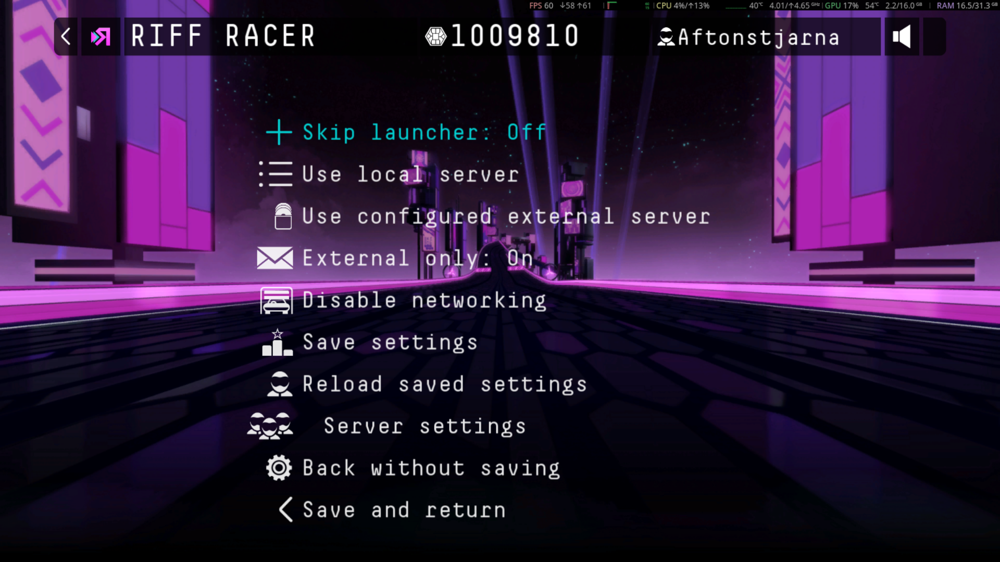
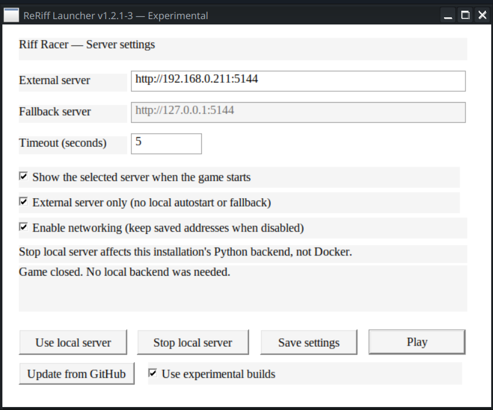

# ReRiff

Restore Riff Racer's local and shared-server features on Windows and Linux/Proton.
ReRiff includes a launcher, automatic updates, and a **native in-game Servers
menu** with controller navigation. Choose a server, keep or disable networking,
save settings, or use **Save and restart** to apply changes immediately.

[Download stable 1.2.1](https://github.com/Aftonstjarna/ReRiff/releases/latest)
· [Install and update](#install-or-update)
· [Steam launch options](#launch-through-steam)
· [Server settings](#server-settings)
· [Troubleshooting](#troubleshooting)
· [Server administration and technical details](#server-administration-and-technical-details)

**Experimental client: Settings → Servers**

The experimental client adds **Servers** as the first entry in the original **Settings** screen.
Existing settings entries remain available with their original actions. Both
Settings lists keep vanilla row spacing and separator lines; scroll to reach
additional entries. The scrollbar reuses the game’s local-track file picker
control. Use the wheel, drag the scrollbar, press Page Up/Down or Home/End,
or navigate up/down with the controller. Friends
keeps its original place on the main menu; restoring its online features is the
next stage of work.

The experimental main menu shows the running **ReRiff version** in its bottom-right
corner, at half the font size of the menu entries. After a successful unattended
update, a click-through notification says
**ReRiff has updated to …**, including the experimental revision. It appears once
at the next main menu, independently of the server-address notification.

**Settings → Graphics → Antialiasing** adds an experimental on/off switch using
the original fullscreen-toggle artwork. Choose **Apply** to save it and enable
post-process edge smoothing. It is Off by default and uses the original
Direct3D 9 renderer on Windows and Proton; unsupported devices fall back to Off.
Back without Apply discards the pending change.

**Native in-game Servers menu — including Save and restart** (stable 1.2.1 shown)



**Launcher and updater** (shown with an earlier experimental build)



In the experimental client, open **Settings → Servers**. Stable 1.2.1 uses a
**Servers** entry in place of Friends. **Save settings** keeps the page open;
**Save and return** returns to the parent menu, and **Save and
restart** saves and restarts the game without another launcher window. Changes
to the active server otherwise apply on the next game start. The launcher's
**Play** button uses saved settings; **Save settings** stores edits separately.

Linux still runs the Windows game through Proton. The native in-game menu does
not remove the game's existing .NET Framework requirements.

## Install or update

**Installers support vanilla and existing ReRiff installations.** Setup verifies
the supported DLL hashes and patches the user's local copies when required.
Original game executables, assets, and game-derived binary patches are not included.

Close the game and launcher before a manual installation. Existing settings,
scores, ghosts, and server data are preserved. Client backups are
kept in the game's `bak` folder. Keep this folder when updating. Unknown game DLL
modifications are rejected rather than overwritten.
Matching vanilla backups are checked by SHA256 and kept unchanged. Verified
originals from an older recorded backup folder are copied into `bak` without
changing that older folder. A conflicting backup hash stops installation
without overwriting the backup.

**Windows:** download and extract `ReRiff-<version>-windows.zip`, run
`ReRiff-Setup.exe`, and select the game's `Game.exe`. Keep the ZIP contents
together until setup finishes. Portable Python and server dependencies are
included. Local DLL patching uses the game's .NET Framework runtime.
The package targets x64 Windows; the launcher is native x86 Win32.

**Linux/Proton (x86_64):** install Python 3.10 or newer. The experimental Linux
installer opens a native folder picker and setup window when run without
arguments in a desktop session:

```sh
sh ReRiff-<version>-linux.run
```

Choose the folder containing `Game.exe`, click **Install**, and wait for the
result. **Link Linux music folder** is checked by default. Its editable field
uses your XDG Music location (usually `~/Music`). Setup links that folder into
this game's Proton prefix at `drive_c/users/steamuser/Music`, so the game can
browse your music. Uncheck it to skip linking; this preference is retained for
automatic updates. Existing non-empty Music folders inside the prefix are
preserved. If Steam has not created the prefix yet, launch the game once and
rerun setup to apply the link. Terminal installs accept `--music-dir '/your/music'`
or `--no-music-link`. GTK 3 is required for the window and is available on many Steam desktops.
The installer shows progress and details, keeps a log under
`~/.local/state/reriff/` (or `$XDG_STATE_HOME/reriff/`), and reuses the same backup,
verification, and rollback checks as Windows. Choosing a folder alone changes
nothing. A failed installation can be retried from the window.

For a terminal install, a machine without GTK, or the current stable installer:


```sh
sh ReRiff-<version>-linux.run --game-dir '/path/to/steamapps/common/Riff Racer'
```

Replace `<version>` with the downloaded release number. Omit `--game-dir` to
search common Steam libraries (including Flatpak Steam). Use `--cli` to force
terminal mode in the experimental installer, or `--gui` to request the window.
Explicit options such as `--game-dir`, `--dry-run`, `--restore`, and `--help`
keep their terminal behavior for scripts and automatic updates. Do not use `sudo`. The installer bundles the
server libraries and places the backend in `localserver/` beside `Game.exe`.
It does not change Steam's selected Proton version or launch options.
The Linux installer includes the DLL patcher's runtime; a separate Mono or .NET
installation is not required. If an older package reports that Mono is required,
download the current complete Linux installer or retry the update.

If Windows selects an external server but game features stay offline, include
`ReRiff-network.log` from the game folder when reporting the failure. It records
bounded network and assembly-loading exception details. The startup report
collector includes it automatically.

### Automatic client updates

Click **Update from GitHub** while the game is closed. The launcher downloads
the latest stable release for your platform, verifies its SHA256 and package
contents, applies the update with backups and rollback, then reopens itself.
The title bar shows the running version. Settings and saved data are retained.

If you are using a prerelease, **uncheck Use experimental builds** while the
game is closed to install stable 1.2.1. This works even when your installed
version has a revision suffix such as `1.2.1-4`. Superseded prereleases are
archived; they are not offered as current updates.

If your launcher cannot apply an update, install the current release manually.
Client updates do not update the Docker server.

### In-game Servers menu and launcher skipping

In the experimental client, open **Settings → Servers** and use the original
fullscreen-style on/off switches for **Skip launcher**, **External only**, and
**Force Offline** (Off enables networking; On disables it without clearing server
addresses). Stable 1.2.1 uses the **Servers** entry on the main menu and text
toggles. After changing Skip launcher, choose
**Save settings** or **Save and return**. The next start uses this preference;
Back without saving discards the change. The preference is stored in
`server.ini` as `[launcher] skip_launcher=true` or `false`. The launcher's
**Skip launcher** checkbox edits this same preference and refreshes when you
save it in-game. Choose **Save settings** in the launcher to save checkbox edits.

Beside it, **Auto-update when skipping launcher** enables an update check before
starting the game without the launcher window. A small progress window shows
checking, downloading, verification and installation. **Cancel** starts the
installed game; it is disabled once installation is committed, so replacement
or rollback can finish safely. It is Off by default, follows
the installed stable/experimental channel, and resumes the game after an update
with the original arguments. A failed check starts the installed version and
records details in `ReRiff-launcher.log`. Existing settings and saved data are
preserved. To test this path without a duplicate GitHub release, close the game
and run `ReRiff-Launcher.exe --skip-launcher --test-auto-update`. This one launch
can reinstall the same published version using the normal verified updater,
then resume the game without checking again. It will not downgrade to an older
published version; the installed release must include this flag.

This option is configured in the launcher, with
`[launcher] auto_update_on_skip=true` in `server.ini`.

New INI files include `https://riffapi.hobune.stream/` as a commented external
server example. Updates also install `server.ini.example` alongside the game.
Copy the address into `external_url` to select it; the example does not change
your active server.

**Save and restart**, the third button from the bottom, saves your changes and
restarts the game immediately so the new server settings take effect. It waits
for the current game to exit before starting a replacement and skips the
launcher window during that restart. A save or restart-handoff failure leaves
the current game running.

Use `--show-launcher` to open the launcher even when this preference is on.
`--skip-launcher`, `--launcher-skip`, and `--skip` explicitly skip it. Launcher
flags override the saved preference, so remove a forced skip flag from Steam's
launch options if you want the in-game toggle to control the next start.

## Launch through Steam

On Windows, run `ReRiff-Launcher.exe` beside `Game.exe`. Add `--skip-launcher`
to start the game without the settings window.

On native Windows, Steam launch options can use:

```text
"C:\Steam\steamapps\common\Riff Racer\ReRiff-Launcher.exe" %command%
```

Use your actual game folder and do not surround the whole line with single
quotes. Steam's forwarded command must point to `Game.exe` beside the launcher.
Put launcher flags such as `--skip-launcher` before `%command%`; game arguments
forwarded after `Game.exe` are retained. Use the current launcher for Steam command forwarding.

On Linux, set Steam launch options to the installed bridge, using your game path:

```text
"/path/to/Riff Racer/localserver/steam-launcher.sh" -- %command%
```

To skip the launcher window:

```text
"/path/to/Riff Racer/localserver/steam-launcher.sh" --skip-launcher -- %command%
```

To test an unattended update on Linux, use:

```text
"/path/to/Riff Racer/localserver/steam-launcher.sh" --test-auto-update -- %command%
```

Remove `--test-auto-update` after testing. It implies skipping the launcher for
that invocation. Current bridges also recognize this flag after `%command%`.

The Windows launcher runs in Steam's Proton prefix and starts or reuses the
native Linux Python server when local operation is enabled. Keep your existing
working Proton and .NET setup. In Steam, find the game path with **Properties →
Installed Files → Browse**, then edit **Properties → General → Launch Options**.
Do not put the Windows EXE directly before `%command%` on Linux; use the bridge
above. The launcher waits for the game to exit so Steam keeps the session active.

## Server settings

The launcher edits `server.ini` beside `Game.exe`:

- **External server:** the preferred shared server address, including its port.
- **Fallback server:** normally `http://127.0.0.1:5144` for local play.
- **External server only:** disables local autostart and fallback. An unavailable
  external server leaves game networking disabled.
- **Use local server:** selects local operation.
- **Stop local server:** stops only this installation's Python backend. An
  already stopped server succeeds; Docker and unrelated services are untouched.

Both addresses blank disables Parse networking. Server selection is fixed for
the game session, so restart the game after changing settings. The optional
server notification fades automatically and does not take controller focus.
Borderless/windowed mode gives the most reliable overlay visibility.

Example client configuration:

```ini
[server]
external_url = http://your-server:5144
fallback_url = http://127.0.0.1:5144
timeout_seconds = 5
show_server_popup = true
external_only = false
```

The client probes the external `/classes/Version` endpoint at initialization and
uses the fallback if that probe fails, unless external-only mode is enabled.
A failed upload does not switch databases or retry on another server. Local and
remote databases are separate and are not automatically synchronized. Missing,
unreadable, or invalid configuration disables Parse networking; there is no
hidden localhost destination. URL credentials, query strings and fragments are
not accepted. Unrelated Steam networking remains enabled.

On native Windows the bundled portable Python runs the local backend. On Proton
the launcher bridges to native Linux Python. The backend stays running after the
game closes; use **Stop local server** when needed. Keep one local backend per
installation/port. Automatic local startup expects port 5144.

## Shared leaderboards and ghosts

Use the same server on each client and update both the clients and server.
The launcher registers cached song IDs with the source audio file's SHA256
when the game starts and after it closes. The server links IDs for identical
files, so existing scores, friend leaderboards, ranking counts, and ghosts can
be shared even when clients originally cached different song IDs.

Source audio files must remain accessible. Matching title/artist metadata alone
does not establish identity; different encodings or edited file tags can produce
different hashes. New imports register after the game closes. The server
preserves existing records rather than deleting or rewriting history.

The registry is stored in the server's persistent `song-catalog.json`. Registration
sends song IDs, file hashes, title and artist; it does not send audio bytes or
local file paths. A cached ID already registered to a different hash is rejected.
Duplicate player records rank the best score once per song/mode/version while
keeping the underlying history. Missing historical track assets are not recreated
from a score or cache entry.

For verified legacy repairs, the optional `song-aliases.json` contains equivalence
groups such as `[["first-cached-id", "second-cached-id"]]`. Automatic registration
removes the need to maintain those groups. Never join IDs solely by song title.

## Restore original DLLs

Use a current installer and its verified backups with `--restore --game-dir '...'` to
restore original DLLs while retaining the server, settings, and saved data.
Keep the recorded backup folder. Original game runtime dependencies still apply.

On Linux/Proton:

```sh
sh ReRiff-<version>-linux.run --restore --game-dir '/path/to/Riff Racer'
```

On Windows:

```text
ReRiff-Setup.exe --restore --game-dir "C:\path\to\Riff Racer"
```

`--dry-run` validates a manual
installation without writing files; `--backup-dir` selects an explicit backup
location. By default, verified originals from the previously recorded backup
directory are copied into the game's `bak` folder; the previous copies are kept.

## Troubleshooting

For a white-screen crash on Windows, install the complete package with
`ReRiff-Setup.exe` first; copying the launcher alone leaves required helpers
missing. If the crash persists, run the included collector from the game folder:

```powershell
powershell -NoProfile -ExecutionPolicy Bypass -File ".\Collect-ReRiffStartup.ps1"
```

It prints the path to a report in your temporary folder. Review it before
sharing: it includes local paths and recent client logs. It does not change
game files or Windows settings. The unsigned-helper loader failure (`0x80131044`) is fixed in current builds.
If a different failure persists, send the generated startup report.

- **Game folder not found:** pass `--game-dir` with the folder containing
  `Game.exe`; use Steam's **Browse** button to locate it.
- **Launcher does not open under Proton:** check the quoted bridge path and
  retain `-- %command%`. Use the game's existing working Proton configuration.
- **Old updater reports a stop failure:** install a current release manually
  once. Updated launchers distinguish actual host-helper completion from Wine's
  wrapper exit status, including when no local backend is running.
- **Cannot connect over LAN:** check the saved external URL and port, container
  port mapping/host networking, TCP firewall rule, and `ReRiff-client.log`. A
  public-URL setting alone does not expose a port. Restart the game to reselect.
- **Same song has separate leaderboards:** update the server and both launchers,
  ensure the exact source files are accessible, and relaunch each client. Metadata
  alone cannot recover unknown cached identities.
- **Server will not start:** check `localserver/server-console.log` and
  `ReRiff-launcher.log`; another service may already occupy port 5144.
- **Update fails:** inspect the temporary `update.log` reported by the launcher.
  Download or preflight failure keeps the old launcher open; installation errors
  retain or roll back files. Keep the game's original runtime dependencies.
- **Notification hidden in fullscreen:** use borderless/windowed mode. The
  notification fades automatically and requires no input.

## Server administration and technical details

The player installation and usage instructions are above. The following sections
cover hosting, persistent data, server diagnostics, source builds, and recovery.

## Docker server

The experimental server changes are included in main. Deploy `:latest` for
stable servers; existing `:experimental` deployments can switch to `:latest`
while retaining the same environment and `/data` mount.

The published image is `ghcr.io/aftonstjarna/reriff:latest`. From this repository,
use the supplied Compose configuration:

```sh
export RERIFF_IMAGE=ghcr.io/aftonstjarna/reriff:latest
docker compose pull server
docker compose up -d --no-build server
```

The default port mapping is local-only. For LAN access, configure
`RERIFF_BIND_ADDRESS=0.0.0.0`, set `RERIFF_PUBLIC_URL` to the server's address
including port 5144, and allow TCP 5144 through the server firewall. Configure
each client's external URL to that address. The admin API has no hardened access
control, so use a trusted network.

The persistent `/data` volume contains records, uploaded files, the song catalog,
and request traces. Keep that volume when updating or recreating the container.
A restart alone does not install a newly pulled image; recreate the container
with its existing settings and data mount. Avoid `docker compose down -v` unless
you intend to delete saved data.

### LAN configuration with Compose

Put persistent settings in a `.env` file beside `compose.yaml`:

```ini
RERIFF_IMAGE=ghcr.io/aftonstjarna/reriff:latest
RERIFF_BIND_ADDRESS=0.0.0.0
RERIFF_PORT=5144
RERIFF_PUBLIC_URL=http://your-server:5144
```

Replace `your-server` with the server's reachable IP or hostname. Then run
`docker compose pull server` and `docker compose up -d --no-build server`.
`RERIFF_PUBLIC_URL` controls generated download URLs; it does not open the
firewall, configure TLS, or change the host bind address.

### Host networking and a host data folder

On a Linux Docker host:

```sh
mkdir -p "$HOME/Applications/docker/ReRiff-Server/data"
touch "$HOME/Applications/docker/ReRiff-Server/server.env"
```

Set `RERIFF_PUBLIC_URL=http://your-server:5144` in `server.env`, then run:

```sh
docker run -d --name reriff-server --restart unless-stopped \
  --network host --user "$(id -u):$(id -g)" \
  --env-file "$HOME/Applications/docker/ReRiff-Server/server.env" \
  --mount "type=bind,source=$HOME/Applications/docker/ReRiff-Server/data,target=/data" \
  ghcr.io/aftonstjarna/reriff:latest
```

Do not add `-p` with host networking. The user override makes the container write
as the owner of the host data folder. Without an override, the image runs as
UID/GID 10001; bind-mounted data must be writable by that identity.

To update a `docker run` deployment, pull the new image and recreate the container
using the same network, environment, and data mount. Keep the host data directory.

### Build locally, migrate data, and verify

```sh
docker build -t reriff-server:local .
python3 docker/smoke_test.py --image reriff-server:local
```

The smoke test uses a disposable volume and port. It checks health, admin access,
persistent scores/ghosts, automatic identity mapping, tracing and file URLs.
For Podman, use `--engine podman --image localhost/reriff-server:local` after
building with Podman. Published builds currently target Linux amd64.

To migrate the game's local database into a Compose volume, stop its backend
first and back up the source data, then run:

```sh
docker compose create server
docker compose cp "/path/to/Riff Racer/localserver/server/data/." server:/data/
docker compose run --rm --no-deps --user 0 --entrypoint sh server -c 'chown -R 10001:10001 /data'
docker compose up -d --no-build server
```

Keep the previous client-visible server address where possible; stored file URLs
can still refer to it. The image contains server code and dependencies, not game
binaries or assets. Run one backend process against each data directory.

GitHub's container workflow builds and tests pushes and pull requests. The default
branch publishes `latest` and a commit-specific tag to GHCR; version-tag builds
can publish version tags. GitHub does not deploy or restart your server.

The server News response reports its version and asks older clients to update,
while leaving the game compatibility Version endpoint unchanged.
The image's `VERSION` file supplies that version; `RERIFF_SERVER_VERSION` can
override it explicitly. Normal stored News announcements are retained.

## Admin panel and logs

For a local server, open `http://127.0.0.1:5144/admin`. For a shared server, use
its configured address with `/admin`.

- Client selection: `ReRiff-client.log` beside `Game.exe`.
- Launcher and updates: `ReRiff-launcher.log`; update errors also identify a
  temporary folder containing `update.log`.
- Local backend: `localserver/server-console.log` and
  `localserver/server/data/traces/`.
- Docker: `docker logs reriff-server` and `/data/traces/` inside the container.

Credentials are redacted from structured traces; player and song names remain.

To export Docker diagnostics on the server host:

```sh
docker logs --timestamps reriff-server > reriff-console.log 2>&1
docker cp reriff-server:/data/traces ./reriff-traces
tar -czf reriff-logs.tar.gz reriff-console.log reriff-traces
```

Transfer that archive from the server host if investigation happens on another
machine. No extra logging port is needed. Watch live output with
`docker logs --follow --tail 100 reriff-server` (or `docker compose logs -f server`).

Each server session gets a JSONL trace with request IDs, timestamps, routes,
queries, headers, JSON bodies, response status and duration. Binary content is
represented by size and SHA256. Investigation flags are clues, not proof of a
missing feature; an empty leaderboard can be normal. Local logs cannot show
requests sent directly to another server. Archive old traces as needed.

For a local session summary:

```sh
python3 "/path/to/Riff Racer/localserver/trace-server.py" --report /path/to/session.jsonl
```

## Standalone source server

The compatibility command remains available:

```sh
python3 -m pip install Flask
python3 riffapi-local.py
```

It runs the same server implementation used by Docker and installed clients,
with tracing enabled, binds to localhost, and uses `data/` beside this root script.
`RERIFF_DATA_DIR` (or the legacy `RIFFAPI_DATA_DIR`) can select another data folder.
Source-based song registration also needs the built native catalog library; set
`RERIFF_CATALOG_LIBRARY` to its path in `build/server-sync/`. Docker and the
installers include that library automatically. Set `RERIFF_NEWS_LIBRARY` to
`build/server-sync/libreriff-news.so` for version-aware News in a source-based
server. Installed and Docker servers already include both libraries.

## Build and release

Client source builds use .NET SDK 8 and Zig 0.14.1:

Managed helpers use the committed `Managed/ReRiff.snk` development key for a
reproducible strong-name identity required by the Windows .NET Framework loader.
This public development key is not a publisher certificate or an authentication
secret. Update the patched Parse DLL references together with the helpers.

```sh
dotnet build ClientConfig/ClientConfig.csproj -c Release -o build
dotnet build NewsHeaders/NewsHeaders.csproj -c Release -o build
dotnet build Patcher/InstallerPatcher.csproj -c Release -o build/installer-patcher
python3 scripts/build-linux-patcher.py
# GUI build headers: libgtk-3-dev (Debian/Ubuntu) or gtk3-devel (Fedora).
python3 scripts/build-linux-installer.py --zig /path/to/zig
RERIFF_RELEASE_CHANNEL=stable python3 scripts/build-windows-launcher.py --zig /path/to/zig
python3 scripts/build-song-catalog.py --zig /path/to/zig
```

The launcher, updater, notification DLL, and Windows setup are native Win32.
The server's identity engine is C++; the existing server and installer tools
use Python. The managed client helper retains its .NET Framework target.

For installer builds, obtain the pinned wheels in `packaging/requirements.txt`
and the verified Windows portable Python archive, then run:

```sh
python3 packaging/build_release.py --local-patching --wheels-dir /path/to/wheels --python-zip /path/to/python.zip
```

Updating `VERSION` on `main` triggers a stable client release. The
`codex/experimental-client` branch publishes numbered prerelease revisions. It builds and checks both installers, then publishes assets and
checksums. Each release contains only its own notes; the full changelog remains
in [RELEASE-NOTES.md](RELEASE-NOTES.md). Stable releases are not overwritten. An existing prerelease can be
promoted under its base version after the stable build passes all checks.

The vendored extended backend originates from
[rumbadebu/riffapi-local-extended](https://github.com/rumbadebu/riffapi-local-extended)
at revision `d6b98d2845bfbc8ee2888f805f8f0dc36bb73ede`, based on
rebane2001/riffapi-local. Its Unlicense is retained. ReRiff source is MIT licensed;
bundled dependencies retain their licenses.

## Original-game reconstruction and Linux-port status

For original-game reconstruction work, the required baseline is a byte-for-byte
matching source rebuild of the original Windows executable. That baseline has
**not yet been achieved**. See [matching reconstruction status and tools](Decomp/README.md).
The separate native Linux port's behavior tests do not establish a matching decompilation.

The source recovery and separate native Linux port remain research work. They
are not a replacement executable shipped in the player installer, and driving
in the native port remains disabled pending recovery of the original integration.
