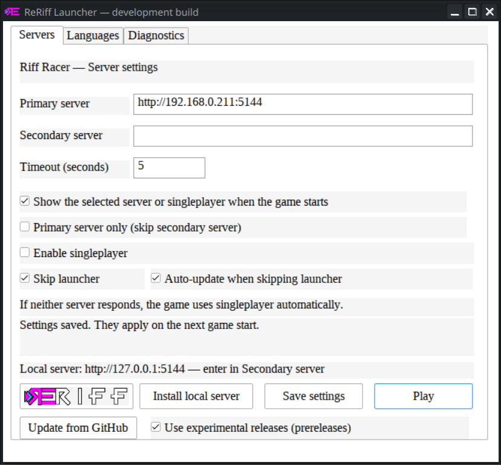
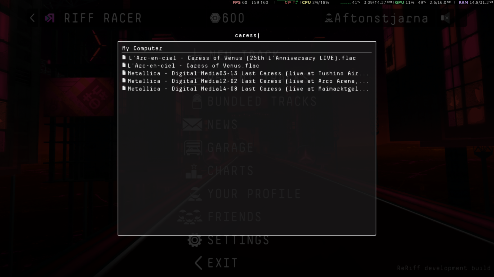
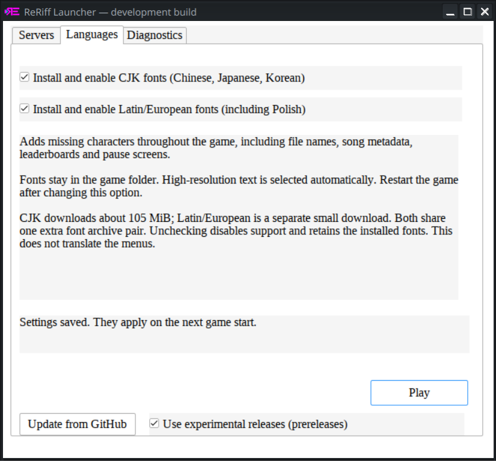
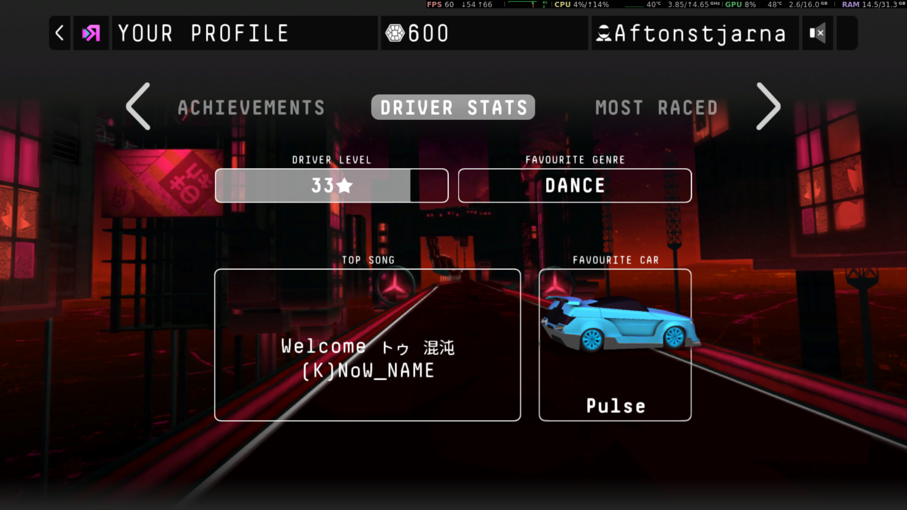
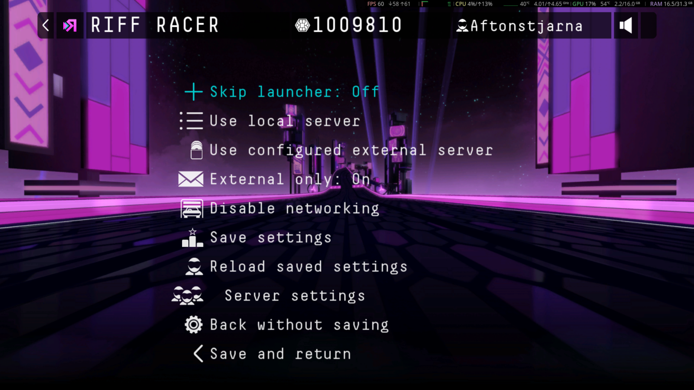
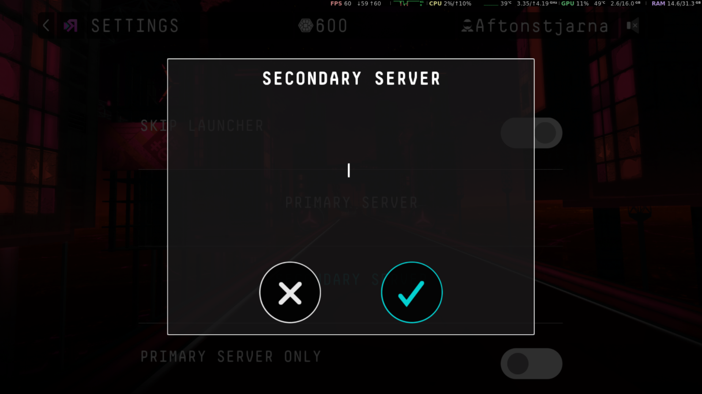
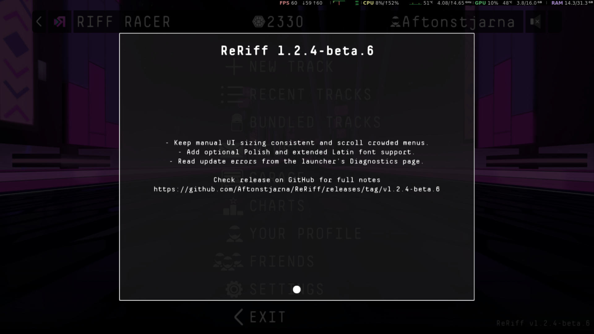
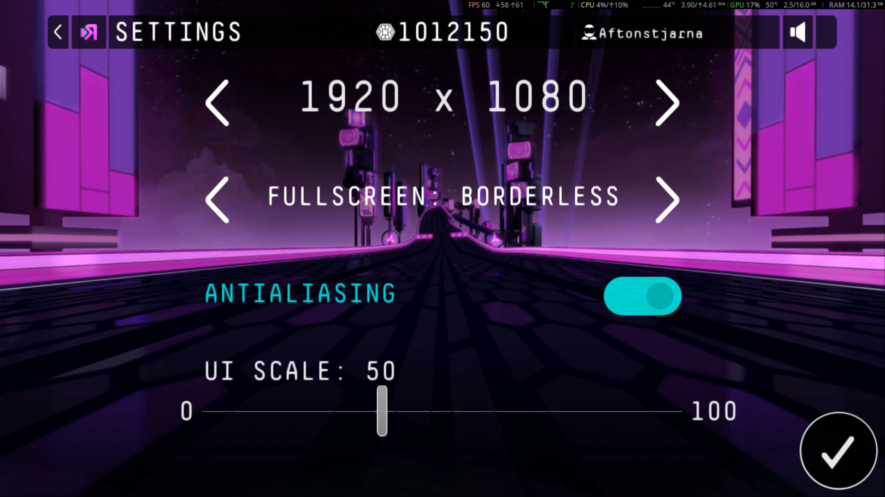
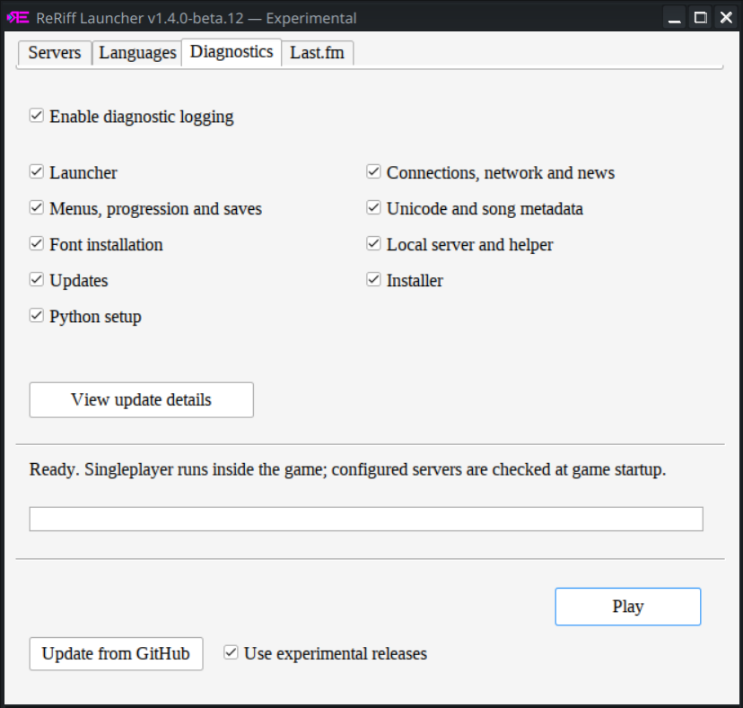

# ReRiff

Play Riff Racer on Windows or Linux/Proton with singleplayer, shared
leaderboards and ghosts.

[Download stable](https://github.com/Aftonstjarna/ReRiff/releases/latest)
· [Beta 1.4.0-beta.6](https://github.com/Aftonstjarna/ReRiff/releases/tag/v1.4.0-beta.6)
· [Install and update](#install-or-update)
· [Steam launch options](#launch-through-steam)
· [Server settings](#server-settings)
· [Graphics settings](#graphics-settings)
· [Troubleshooting](#troubleshooting)
· [Server administration](#server-administration-and-technical-details)

- **Play solo or together:** generate tracks offline, or share leaderboards and
  ghosts through a server with Primary/Secondary fallback.
- **Two-click server setup:** click **Install local server**, then **Start local
  server**. Python, Flask and server dependencies are provided automatically.
  Share the same server with other PCs on your LAN.
- **More characters:** optional Chinese, Japanese, Korean and Latin/European
  fonts for filenames, song metadata, leaderboards and pause screens.
- **Graphics controls:** windowed, borderless and exclusive modes, higher render
  resolutions, antialiasing and UI scale with scrolling menus.
- **Updates and diagnostics:** stable updates by default, opt-in betas and
  readable installation errors in the launcher.

**Launcher — Servers**



Linux play requires Proton and the game's Windows .NET Framework setup.

## Current beta

Stable is the default download and update channel. The opt-in
[1.4.0-beta.6 release](https://github.com/Aftonstjarna/ReRiff/releases/tag/v1.4.0-beta.6)
adds whole-library music search, editable server addresses, experimental prestige
progression and grouped diagnostics. See its release notes for validation and
remaining limitations.

In the music picker, press **Xbox Y**, **Ctrl+F**, or click the search field.
Search includes unimported music in the Music folder, saved favourites, current
folder and cached-track locations. It matches filenames, paths and available
song metadata, including kana and romaji. **Enter/A** finishes editing;
**Esc/B** clears search before Back can leave the picker. Results arrive during
scanning; up to 200 matches are displayed, with a 100,000-audio-file scan limit.



Steam virtual-keyboard input remains unresolved in the tested Proton setup;
automatic summoning is disabled. Use a physical keyboard with Steam's keyboard
closed. M4A files may appear in search, but M4A playback is not supported.

## Install or update

Install into an unmodified game or an existing ReRiff installation. Close the
game and launcher first. Setup checks the game DLLs, applies the required patches
and preserves settings, scores, ghosts and server data.

Keep the game's `.bak` folder: it holds verified originals for restoration.
Setup can copy verified originals from a previously recorded backup folder.
Unsupported DLLs or conflicting backup hashes stop installation for review.

**Windows:** download and extract `ReRiff-<version>-windows.zip`, run
`ReRiff-Setup.exe`, and select the game's `Game.exe`. Keep the ZIP contents
together until setup finishes. The package supports x64 Windows. Setup asks
before downloading a verified private Python runtime into
`localserver/windows-python/` for setup, updates and optional server controls.
You do not need to install Python manually. The private runtime leaves system
Python, PATH and the registry unchanged.
DLL patching uses the game's .NET Framework runtime.

**Linux/Proton (x86_64):** run the installer to open its setup window:

```sh
sh ReRiff-<version>-linux.run
```

Choose the folder containing `Game.exe`, click **Install**, and wait for the
result. **Link Linux music folder** is checked by default. Its editable field
defaults to `~/Music`; you can choose a different folder. Setup links that folder into
this game's Proton prefix at `drive_c/users/steamuser/Music`, so the game can
browse your music. Uncheck it to skip linking; this preference is retained for
automatic updates. Existing non-empty Music folders inside the prefix are
preserved. If Steam has not created the prefix yet, launch the game once and
rerun setup to apply the link. Terminal installs accept `--music-dir '/your/music'`
or `--no-music-link`.

The setup window requires GTK 3. It shows progress and writes diagnostics to
`~/.local/state/reriff/` (or `$XDG_STATE_HOME/reriff/`). If installation fails,
review the details and retry from the same window.

For a terminal install or a machine without GTK:

```sh
sh ReRiff-<version>-linux.run --game-dir '/path/to/steamapps/common/Riff Racer'
```

Replace `<version>` with the downloaded release number. Omit `--game-dir` to
search common Steam libraries (including Flatpak Steam). Use `--cli` to force
terminal mode, or `--gui` to request the window.
Explicit options such as `--game-dir`, `--dry-run`, `--restore`, and `--help`
keep their terminal behavior for scripts and automatic updates. Do not use `sudo`.
Setup keeps your Steam Proton selection and launch options. Update helpers live
in `localserver/` beside `Game.exe`.

**Linux dependencies:** setup and updates use a self-contained patcher and
client helper. No host Python or separate .NET installation is needed for these
tools. The optional server AppImage includes Flask, Python and its libraries;
it is downloaded only when you choose **Install local server**. The game still
requires its Windows .NET Framework setup inside Proton.

If Windows selects an external server but game features stay offline, include
the connection logs listed under [Admin panel and logs](#admin-panel-and-logs)
when reporting the failure.
The startup report collector includes available connection logs automatically.

Failed updates show a reason in the launcher. Open **Diagnostics → View update
details** for scrollable temporary error details and saved update-log entries.
Viewing details does not enable diagnostic logging.

### Optional language fonts



Check **Install and enable CJK font support** during setup, or open the launcher's
**Languages** tab and check **Install and enable CJK fonts**. The component adds
missing Chinese, Japanese and Korean characters throughout the game; it does not
translate menus. The CJK pack is about 105 MiB.

A separate **Latin/European fonts** checkbox adds missing letters such as Polish
`ł`, `ą` and `ę`. Its Noto Sans download is about 350 KiB. You can select either
pack or both; both share the same single additional VFS pair.

Setup includes the font pack. The launcher downloads and verifies it if needed;
re-enabling an installed pack works offline. Restart the game after changing the
checkbox. Unchecking disables support and keeps the font files for later use.

Fonts and the Noto Open Font License stay in the game folder. Installation uses
one additional native VFS pair (`.dat` and `.zip`) and retains the original game archives and other
mods. Updates refuse changed owned files. The tested Japanese glyph forms are
used across CJK text; regional typography selection is not yet available.



### Automatic client updates

Setup includes a link to the GitHub repository.

Click **Update from GitHub** while the game is closed. The launcher downloads
the latest stable release for your platform, verifies its SHA256 and package
contents, applies the update with backups and rollback, then reopens itself.
The title bar shows the running version. Settings and saved data are retained.

Stable is the default channel. Check **Use experimental releases (prereleases)**
to test betas, or uncheck it to return to stable. New betas use `X.X.X-beta.N`,
with older `X.X.X-N` names retained for updater compatibility.

Experimental updates select the most recently published GitHub prerelease;
stable updates use GitHub Latest. The updater verifies the selected release's
package and skips an already installed version unless you switch channels or
request a test reinstall.

If an older launcher cannot recognize beta names or download current installers,
install the current release manually once. Your settings and saved data are
preserved.
Client updates do not update the Docker server.

### In-game Servers menu and launcher skipping



Open **Settings → Servers** to change **Skip launcher**, **Primary server only**
and **Singleplayer**. Save your changes with **Save settings** or **Save and
return**. **Return without saving** discards edits. The launcher edits the same
preferences in `server.ini` (split between `server.ini` and `client.ini` in the
1.4.0 beta).

**In the 1.4.0 beta**, select Primary or Secondary server to edit its address
in-game, then confirm or cancel the text entry.



**Skip launcher** takes effect on the next start. Fresh installs show the launcher.

In the launcher, **Auto-update when skipping launcher** checks the selected
release channel before starting the game. It starts Off. A progress window shows
the check and installation. **Cancel** starts the installed game; cancellation
is disabled during file replacement and rollback. A failed check starts the
installed version and records details in `logs/ReRiff-launcher.log`.

To test an unattended update, close the game and run
`ReRiff-Launcher.exe --skip-launcher --test-auto-update`. This reinstalls the
selected published package, then starts the game. It can replace a local
development build with the channel's published version. The installed launcher
must support this flag.

**Save and restart** saves your changes and
restarts the game immediately so the new server settings take effect. It waits
for the current game to exit before starting a replacement and skips the
launcher window during that restart. A save or restart-handoff failure leaves
the current game running.

Use `--show-launcher` to open the launcher even when this preference is on.
`--skip-launcher`, `--launcher-skip`, and `--skip` explicitly skip it. Launcher
flags override the saved preference, so remove a forced skip flag from Steam's
launch options if you want the in-game toggle to control the next start.

## Launch through Steam

On Windows, run `ReRiff-Launcher.exe` beside `Game.exe`. Add `--skip-launcher`
to start the game without the settings window.

On native Windows, Steam launch options can use:

```text
"C:\Steam\steamapps\common\Riff Racer\ReRiff-Launcher.exe" %command%
```

Use your actual game folder and do not surround the whole line with single
quotes. Steam's forwarded command must point to `Game.exe` beside the launcher.
Put launcher flags such as `--skip-launcher` before `%command%`; game arguments
forwarded after `Game.exe` are retained. Use the current launcher for Steam command forwarding.

On Linux, use **ReRiff-Launcher.sh** beside `ReRiff-Launcher.exe` to launch
through Steam's Proton:

```text
"/path/to/Riff Racer/ReRiff-Launcher.sh" -- %command%
```

To skip the launcher window:

```text
"/path/to/Riff Racer/ReRiff-Launcher.sh" --skip-launcher -- %command%
```

To test an unattended update on Linux, use:

```text
"/path/to/Riff Racer/ReRiff-Launcher.sh" --test-auto-update -- %command%
```

Remove `--test-auto-update` after testing. It implies skipping the launcher for
that invocation. Current bridges also recognize this flag after `%command%`.

The older `localserver/steam-launcher.sh` path remains supported for existing
Steam launch options, with the same argument forwarding. Do not use the Windows `.exe`
directly before `%command%` on Linux.

The Windows launcher runs in Steam's Proton prefix. Singleplayer storage runs
inside the game; the launcher does not start a local Python server. Keep your existing
working Proton and .NET setup. In Steam, find the game path with **Properties →
Installed Files → Browse**, then edit **Properties → General → Launch Options**.
The launcher waits for the game to exit so Steam keeps the session active.

Open **News** for the installed client's patch notes and server announcements.
Choose **Visit URL** for that release's full notes on GitHub. News
shows up to three concise summary points. Client notes ship with the installer;
delivery diagnostics use the connection logs described below when logging is enabled.



The launcher, profile, address-editor and search screenshots show a development
build of the 1.4.0 beta features. Other screenshots may show earlier releases.

## Server settings

The launcher edits `server.ini` beside `Game.exe`:

- **Primary server:** preferred shared server address, including its port.
  The public ReRiff service is `https://official-na-east.reriff.online`.
- **Secondary server:** optional fallback, such as another shared server or
  the launcher-managed server at `http://127.0.0.1:5144` on this PC.
- **Primary server only:** skips the secondary server; singleplayer remains available.
- **Singleplayer:** selects local play while retaining both saved server addresses.
- **Use servers:** enables primary → secondary → singleplayer selection.

In the 1.4.0 beta, shared graphics, language, launcher and logging preferences
live in `client.ini`.
Singleplayer progression and balance live in `singleplayer.ini`. The optional
LAN service uses `localserver/server.ini`. Existing combined configurations
migrate automatically; see [configuration files](https://github.com/Aftonstjarna/ReRiff/blob/codex/experimental-client/docs/CONFIGURATION.md).

### Quick deploy a local or LAN server

1. Click **Install local server** in the launcher. It downloads and verifies the
   optional server and its dependencies.
2. Click **Start local server**. The button becomes **Stop local server**.

No separate Python installation or container engine is needed. Windows uses a
private Python runtime and bundled Flask dependencies; Linux/Proton uses a
self-contained server AppImage. The server is downloaded on demand rather than
included in the client installer.

On the host PC, enter `http://127.0.0.1:5144` in **Secondary server**, enable
**Use servers**, leave **Primary server only** unchecked, and save. Primary is
tried first. To use only your local server, leave Primary empty.

**LAN access:** other PCs can use `http://<host-LAN-IP>:5144` in
Primary or Secondary. Start reports the detected LAN address in the launcher.
Allow inbound TCP port **5144** on the host's private-network firewall. All
clients use the same saved data. The host's launcher controls and admin page
remain localhost-only.

**Upgrading an existing local server:** stop it, click **Update local server**,
then **Start local server**. This downloads the server matching your client
release and preserves its configuration, scores and ghosts. Client updates
alone do not replace the optional server application.

An installed server starts with **Play** when its exact localhost address is
configured and networking is enabled. A server started by that launch stops
when the game closes; one already running is left running. Start it manually
to keep it available to other players. Stop preserves data. An unrelated
service on its port is never adopted or stopped.

Configuration lives in `localserver/native/config.json`, saved data in
`localserver/data`, and optional logs in `logs/ReRiff-localserver.log`.
Back up the data folder to preserve server progress. The admin page is
`http://127.0.0.1:5144/admin` on the host PC.

Stable installs retain original game files in `.bak/originals/` and the two
most recent backups per configuration file in `.bak/configs/`. Replaced ReRiff
binaries and font packs are not retained after a successful update.

Backing out of Servers or Graphics with unsaved changes prompts you to apply
or discard them. Press Back inside the prompt to keep editing.

The Servers menu offers **Save settings**, **Reload saved settings**, then
**Return without saving**, **Save and return**, **Save and restart**, and
**Save and exit**. The last two save your preferences before restarting or closing
the game. The main menu shows the client version. Startup notifications show the
selected server or singleplayer and announce successful unattended updates.

Both addresses blank selects singleplayer. The game probes each configured server's
`/classes/Version` endpoint in order. If neither responds, it starts singleplayer
inside the game process. Use **Settings → Servers → Singleplayer** to select
local play directly.

```ini
[server]
external_url = http://your-server:5144
fallback_url = http://your-secondary-server:5144
timeout_seconds = 5
show_server_popup = true
external_only = false
networking_enabled = true
```

Set `networking_enabled = false` to force singleplayer without probing either
server. Saved addresses remain intact. Save settings, then restart the game to
apply a selection. The optional startup notification displays Singleplayer or
the chosen server.

Selection stays fixed for the game session. Failed writes are never replayed to
another database. Singleplayer, primary and secondary databases remain separate;
remote scores are not automatically synchronized into singleplayer. Missing or
invalid configuration selects singleplayer. URL credentials, query strings and
fragments are not accepted.

Singleplayer keeps scores, profiles, track metadata and ghost files in the game's
`singleplayer/` folder. On first use, existing `localserver/server/data/classes` and `files` are copied
into singleplayer without moving or modifying the old data. Stop the old backend
before this first import to get a consistent snapshot. Existing server addresses
are preserved; choose Singleplayer to replace a previously configured localhost
backend. See the [dedicated server instructions](#docker-server) for shared hosting.

## Graphics settings



Choose **Off (Windowed)**, **Borderless** or **Exclusive** fullscreen. Borderless
can render above the monitor resolution and scale down to fit the display.
**Alt+Enter** switches between windowed and the selected fullscreen mode.

**Antialiasing** smooths edges and starts Off. **UI Scale** is independent of
render resolution: **0 (Auto)** uses the game's automatic size, **25** is Small,
**50** the 1080p reference, **75** Large and **100** Very Large. Scroll to reach
settings that do not fit on screen.

Choose **Apply** to save changes. Display changes show a Keep/Revert confirmation
and revert after **10 seconds** unless accepted. Backing out with unsaved edits
prompts to apply or discard them.

## Shared leaderboards and ghosts

Use the same server on each client and update both the clients and server.
The launcher registers cached song IDs with the source audio file's SHA256
when the game starts and after it closes. The server links IDs for identical
files, so existing scores, friend leaderboards, ranking counts, and ghosts can
be shared even when clients originally cached different song IDs.

Source audio files must remain accessible. Matching title/artist metadata alone
does not establish identity; different encodings or edited file tags can produce
different hashes. New imports register after the game closes. The server
preserves existing records rather than deleting or rewriting history.

The registry is stored in the server's persistent `song-catalog.json`. Registration
sends song IDs, file hashes, title and artist; it does not send audio bytes or
local file paths. A cached ID already registered to a different hash is rejected.
Duplicate player records rank the best score once per song/mode/version while
keeping the underlying history. Missing historical track assets are not recreated
from a score or cache entry.

For verified legacy repairs, the optional `song-aliases.json` contains equivalence
groups such as `[["first-cached-id", "second-cached-id"]]`. Automatic registration
removes the need to maintain those groups. Never join IDs solely by song title.

## Restore original DLLs

Use a current installer and its verified backups with `--restore --game-dir '...'` to
restore original DLLs while retaining the server, settings, and saved data.
Keep the recorded backup folder. Original game runtime dependencies still apply.

On Linux/Proton:

```sh
sh ReRiff-<version>-linux.run --restore --game-dir '/path/to/Riff Racer'
```

On Windows:

```text
ReRiff-Setup.exe --restore --game-dir "C:\path\to\Riff Racer"
```

`--dry-run` validates a manual
installation without writing files; `--backup-dir` selects an explicit backup
location. By default, verified originals from the previously recorded backup
directory are copied into the game's `.bak` folder; the previous copies are kept.

## Troubleshooting



Enable **Diagnostic logging** in setup or the launcher's **Diagnostics** tab
before reproducing an issue. Logging defaults on for beta/development builds
and off for stable builds; an explicit choice is retained across updates.
The game creates `logs` only when logging is enabled. Disabling it keeps
existing logs and the folder unchanged. Restart a running local server after
changing its logging setting. Review logs before sharing them.

**Previously generated FLAC tracks have the wrong duration:** current builds
correct the original decoder's sample-rate handling for new analysis. Old cached
analysis can retain the timing error; generate a fresh track rather than reusing
that cache. See [the FLAC investigation](reports/FLAC-SAMPLE-RATE.md).

For a white-screen crash on Windows, install the complete package with
`ReRiff-Setup.exe` first; copying the launcher alone leaves required helpers
missing. If the crash persists, run the included collector from the game folder:

```powershell
powershell -NoProfile -ExecutionPolicy Bypass -File ".\logs\Collect-ReRiffStartup.ps1"
```

It prints the path to a report in the game's `logs` folder. Review it before
sharing: it includes local paths and recent client logs. It does not change
game files or Windows settings. The unsigned-helper loader failure (`0x80131044`) is fixed in current builds.
If a different failure persists, send the generated startup report.

- **Game folder not found:** pass `--game-dir` with the folder containing
  `Game.exe`; use Steam's **Browse** button to locate it.
- **Launcher does not open under Proton:** check the quoted bridge path and
  retain `-- %command%`. Use the game's existing working Proton configuration.
- **Old updater reports a stop failure:** install a current release manually
  once. Updated launchers distinguish actual host-helper completion from Wine's
  wrapper exit status, including when no local backend is running.
- **Cannot connect over LAN:** check the saved external URL and port, container
  port mapping/host networking, TCP firewall rule, and the connection logs below. A
  public-URL setting alone does not expose a port. Restart the game to reselect.
- **Same song has separate leaderboards:** update the server and both launchers,
  ensure the exact source files are accessible, and relaunch each client. Metadata
  alone cannot recover unknown cached identities.
- **Server will not start:** enable logging in **Diagnostics**, retry, and check
  `logs/ReRiff-localserver.log` and `logs/ReRiff-launcher.log`; another service
  may already occupy port 5144.
- **Update fails:** inspect the temporary `update.log` reported by the launcher.
  Download or preflight failure keeps the old launcher open; installation errors
  retain or roll back files. Keep the game's original runtime dependencies.
- **Notification hidden in fullscreen:** use windowed mode. The
  notification fades automatically and requires no input.

## Server administration and technical details

Hosting, diagnostics and source build instructions follow.

## Docker server

Use `:latest` for stable server deployments. Keep the same environment and
`/data` mount when updating or switching release channels.

The published image is `ghcr.io/aftonstjarna/reriff:latest`. From this repository,
use the supplied Compose configuration:

```sh
export RERIFF_IMAGE=ghcr.io/aftonstjarna/reriff:latest
docker compose pull server
docker compose up -d --no-build server
```

The default port mapping is local-only. For LAN access, configure
`RERIFF_BIND_ADDRESS=0.0.0.0`, set `RERIFF_PUBLIC_URL` to the server's address
including port 5144, and allow TCP 5144 through the server firewall. Configure
each client's external URL to that address. The admin API has no hardened access
control, so use a trusted network.

The persistent `/data` volume contains records, uploaded files, the song catalog,
and request traces. Keep that volume when updating or recreating the container.
A restart alone does not install a newly pulled image; recreate the container
with its existing settings and data mount. Avoid `docker compose down -v` unless
you intend to delete saved data.

### LAN configuration with Compose

Put persistent settings in a `.env` file beside `compose.yaml`:

```ini
RERIFF_IMAGE=ghcr.io/aftonstjarna/reriff:latest
RERIFF_BIND_ADDRESS=0.0.0.0
RERIFF_PORT=5144
RERIFF_PUBLIC_URL=http://your-server:5144
```

Replace `your-server` with the server's reachable IP or hostname. Then run
`docker compose pull server` and `docker compose up -d --no-build server`.
`RERIFF_PUBLIC_URL` controls generated download URLs; it does not open the
firewall, configure TLS, or change the host bind address.

### Public and LAN addresses for one server

Configure both addresses as permanent aliases of the same persistent store:

```ini
RERIFF_PUBLIC_URL=https://reriff.example.net
RERIFF_LAN_URL=http://192.0.2.10:5144
```

Use your real addresses in `.env` for the repository Compose file, or in
`server.env` for the host deployment below. Both routes use `/data` and its
persistent `server-id`; they share profiles, scores, ghosts, and uploaded files.
Responses use the configured address matching the request's Host header.
Public HTTPS is retained behind an HTTP reverse proxy, which must preserve the
original Host header. Unconfigured forwarded hosts cannot override file URLs.

Saved Parse File URLs belonging to either alias are adapted in API responses;
the stored JSON, object IDs, and binary files remain unchanged. LAN uploads and
downloads do not require public DNS or an internet connection. Configure Public
as the client's Primary address, LAN as Secondary, and leave Primary-only off.
Any public proxy must permit the game's API requests.

Do not set `RERIFF_MIGRATE_FROM_ORIGIN` when both addresses must coexist. If it
was previously configured, remove it. Links already migrated to Public are also
adapted for LAN responses when both aliases are present. To retire an old address
permanently, set `RERIFF_MIGRATE_FROM_ORIGIN` to that old HTTP(S) origin and
`RERIFF_PUBLIC_URL` to the replacement. Startup performs a one-time migration of
owned file URLs, retaining original records and a completion manifest under
`/data/migrations/file-origin-*`.

Each store keeps its UUID in `/data/server-id`. Preserve it with the data and
backups. Root JSON, `/classes/Version`, and the `X-ReRiff-Server-ID` response
header expose the same identity. Do not copy an ID between independent stores
to force a match; identity does not merge their data.

### Host networking and a host data folder

On a Linux Docker host:

```sh
mkdir -p "$HOME/Applications/docker/ReRiff-Server/data"
touch "$HOME/Applications/docker/ReRiff-Server/server.env"
```

Set `RERIFF_PUBLIC_URL=http://your-server:5144` in `server.env`, then run:

```sh
docker run -d --name reriff-server --restart unless-stopped \
  --network host --user "$(id -u):$(id -g)" \
  --env-file "$HOME/Applications/docker/ReRiff-Server/server.env" \
  --mount "type=bind,source=$HOME/Applications/docker/ReRiff-Server/data,target=/data" \
  ghcr.io/aftonstjarna/reriff:latest
```

Do not add `-p` with host networking. The user override makes the container write
as the owner of the host data folder. Without an override, the image runs as
UID/GID 10001; bind-mounted data must be writable by that identity.

To update a `docker run` deployment, pull the new image and recreate the container
using the same network, environment, and data mount. Keep the host data directory.

### Build locally, migrate data, and verify

```sh
docker build -t reriff-server:local .
python3 docker/smoke_test.py --image reriff-server:local
```

The smoke test uses a disposable volume and port. It checks health, admin access,
persistent scores/ghosts, automatic identity mapping, tracing and file URLs.
For Podman, use `--engine podman --image localhost/reriff-server:local` after
building with Podman. Published builds currently target Linux amd64.

To migrate the game's local database into a Compose volume, stop its backend
first and back up the source data, then run:

```sh
docker compose create server
docker compose cp "/path/to/Riff Racer/localserver/server/data/." server:/data/
docker compose run --rm --no-deps --user 0 --entrypoint sh server -c 'chown -R 10001:10001 /data'
docker compose up -d --no-build server
```

Keep the previous client-visible server address where possible; stored file URLs
can still refer to it. The image contains server code and dependencies, not game
binaries or assets. Run one backend process against each data directory.

GitHub's container workflow builds and tests pushes and pull requests. The default
branch publishes `latest` and a commit-specific tag to GHCR; version-tag builds
can publish version tags. GitHub does not deploy or restart your server.

The server News response reports its version and asks older clients to update,
while leaving the game compatibility Version endpoint unchanged.
The image's `VERSION` file supplies that version; `RERIFF_SERVER_VERSION` can
override it explicitly. Normal stored News announcements are retained.

## Admin panel and logs

For a local server, open `http://127.0.0.1:5144/admin`. For a shared server, use
its configured address with `/admin`.

In 1.4.0-beta.6 and later, related diagnostics share files and retain component
labels. The launcher exposes nine categories. Older per-component preferences
are preserved until you change their group; superseded logs move to
`logs/archive/` during installation.

- Connections, server selection and News: `logs/ReRiff-connections.log`.
- Native menus and singleplayer progression: `logs/ReRiff-game.log`.
- Text input, Unicode and metadata: `logs/ReRiff-text.log`.
- Launcher: `logs/ReRiff-launcher.log`; updates: `logs/update.log`.
- Optional local server: `logs/ReRiff-localserver.log`.
- Setup: `logs/installer.log` on Windows and `logs/installer-*.log` on Linux.
  Private Python downloads: `logs/ReRiff-python-setup.log` on Windows.
  Startup collection reports are also saved under `logs/`.
- Legacy local backend: `localserver/server-console.log` and
  `localserver/server/data/traces/`.
- Docker: `docker logs reriff-server` and `/data/traces/` inside the container.

Stable 1.3.2 still uses separate `ReRiff-client.log`, `ReRiff-network.log`,
`ReRiff-news.log`, `ReRiff-engine-menu.log`, `ReRiff-singleplayer.log`,
`ReRiff-unicode.log` and `ReRiff-metadata.log` files under `logs/`.

Credentials are redacted from structured traces; player and song names remain.

To export Docker diagnostics on the server host:

```sh
docker logs --timestamps reriff-server > reriff-console.log 2>&1
docker cp reriff-server:/data/traces ./reriff-traces
tar -czf reriff-logs.tar.gz reriff-console.log reriff-traces
```

Transfer that archive from the server host if investigation happens on another
machine. No extra logging port is needed. Watch live output with
`docker logs --follow --tail 100 reriff-server` (or `docker compose logs -f server`).

Each server session gets a JSONL trace with request IDs, timestamps, routes,
queries, headers, JSON bodies, response status and duration. Binary content is
represented by size and SHA256. Investigation flags are clues, not proof of a
missing feature; an empty leaderboard can be normal. Local logs cannot show
requests sent directly to another server. Archive old traces as needed.

For a local session summary:

```sh
python3 "/path/to/Riff Racer/localserver/trace-server.py" --report /path/to/session.jsonl
```

## Standalone source server

The compatibility command remains available:

```sh
python3 -m pip install Flask
python3 riffapi-local.py
```

It runs the same server implementation used by the Docker image,
with tracing enabled, binds to localhost, and uses `data/` beside this root script.
`RERIFF_DATA_DIR` (or the legacy `RIFFAPI_DATA_DIR`) can select another data folder.
Source-based song registration also needs the built native catalog library; set
`RERIFF_CATALOG_LIBRARY` to its path in `build/server-sync/`. Docker images include that library automatically. Set `RERIFF_NEWS_LIBRARY` to
`build/server-sync/libreriff-news.so` for version-aware News in a source-based
server. The Docker image already includes both libraries; singleplayer needs neither.

## Build and release

Client source builds use .NET SDK 8 and Zig 0.14.1.

On the experimental branch, unpublished local builds display **development build** in both the launcher and
game. The native build script detects a clean matching version tag; use
`--development` to force the development label or `--release` when producing an
official versioned package. Release workflows explicitly select `--release`.

Managed helpers use the committed `Managed/ReRiff.snk` development key for a
reproducible strong-name identity required by the Windows .NET Framework loader.
This key provides assembly identity for the loader. Publisher signing requires
a separate certificate. Update patched Parse DLL references with the helpers.

```sh
dotnet build ClientConfig/ClientConfig.csproj -c Release -o build
dotnet build NewsHeaders/NewsHeaders.csproj -c Release -o build
dotnet build Patcher/InstallerPatcher.csproj -c Release -o build/installer-patcher
python3 scripts/build-linux-patcher.py
# GUI build headers: libgtk-3-dev (Debian/Ubuntu) or gtk3-devel (Fedora).
python3 scripts/build-linux-installer.py --zig /path/to/zig
RERIFF_RELEASE_CHANNEL=stable python3 scripts/build-windows-launcher.py --zig /path/to/zig
python3 scripts/build-song-catalog.py --zig /path/to/zig
python3 scripts/build-windows-server.py
python3 scripts/fetch-font-components.py
# Build-time container engine only; players do not need it.
bash scripts/build-linux-runtime.sh
```

Font packs are built and versioned in [ReRiff-Fonts](https://github.com/Aftonstjarna/ReRiff-Fonts).
Client builds reuse the release pinned in `packaging/fonts/release.json` and
verify its checksums. Language installation checks still run for each client.

The launcher, updater, notification DLL, and Windows setup are native Win32.
The server's identity engine is C++. The server backend and Windows installation
tools use Python; Linux installation and updates use the self-contained patcher.
The managed game helper retains its .NET Framework target.

The optional Linux server AppImage is built in an Arch container with a pinned
AnyLinux sharun deployer. It includes Flask, Python, shared libraries, CA
certificates and dependency licenses. The Linux client helper uses the existing
self-contained .NET patcher runtime. Run `scripts/test_native_client.py` for
installation/update regressions and `scripts/test-linux-runtime.py` for server
lifecycle, persistence and port-conflict checks without host Python or a container engine.
SteamOS/Bazzite and NixOS desktop integration still need real-machine testing.

For installer builds, build the client helpers and both optional server packages, then run:

```sh
python3 packaging/build_release.py --local-patching
```

Launcher, client mod and server have independent checks and can be developed
in separate worktrees. See [parallel component development](https://github.com/Aftonstjarna/ReRiff/blob/codex/experimental-client/docs/COMPONENT-WORKFLOWS.md)
for source ownership, build commands and integration boundaries.

Updating `VERSION` on `main` triggers a stable client release. The
`codex/experimental-client` branch publishes betas named `X.X.X-beta.N`.
The workflow builds and checks both installers before publishing assets and
checksums. Each release has its own notes; the full changelog is in
[RELEASE-NOTES.md](RELEASE-NOTES.md). Publish the stable base version after its
build passes all checks.

### Repository history

Some older commits appear more than once with the same title. The history
contains parallel versions of an older commit chain with different parent
hashes, later joined by merges. Several pairs have identical file snapshots;
others differ. Repeated titles do not mean features are installed or run twice.
Published history and release tags are retained so existing release references
continue to identify their tested commits.

GitHub provides the source ZIP and tarball for each release automatically;
there is no separately uploaded source archive. For version-specific changes,
use the release notes rather than counting repeated commit titles.

The vendored extended backend originates from
[rumbadebu/riffapi-local-extended](https://github.com/rumbadebu/riffapi-local-extended)
at revision `d6b98d2845bfbc8ee2888f805f8f0dc36bb73ede`, based on
rebane2001/riffapi-local. Its Unlicense is retained. ReRiff source is MIT licensed;
bundled dependencies retain their licenses.

## Original-game reconstruction and Linux-port status

[RiffRacerDecomp](https://github.com/Aftonstjarna/RiffRacerDecomp) tracks source
recovery and byte comparisons against the original Windows executable. A fully
byte-matching rebuild remains unfinished.

The native Linux port is also research work. Driving is disabled pending recovery
of the original integration. Linux player releases run the Windows game through Proton.
